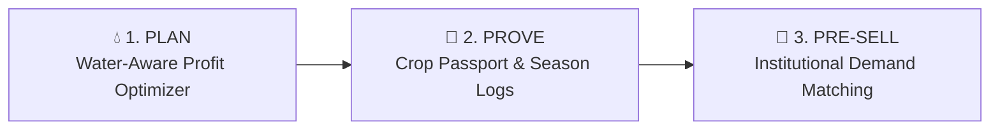

# 🌾 FasalSetu (फसलसेतु)
> **"Paani se planning. Bharose se selling."**
> A mobile-first Progressive Web App (PWA) that empowers small Indian farmers (1–5 acres) to **PLAN** crops by water efficiency, **PROVE** their season with a verifiable Crop Passport, and **PRE-SELL** produce to bulk buyers before harvest.

---

## 🌟 Key Pillars



1. **PLAN (Before Sowing):**
   - Ranks crops by profit per 1,000 litres of water ($\text{₹/KL}$).
   - **Water-Budget Optimizer:** Linear program maximizing total profit subject to total water $\le$ budget, total land $\le$ acres, and each crop $\le 50\%$ of land.
   - Interactive water slider ($-50\%$ to $+20\%$) showing expected profit, water used, acres per crop, and leftover fallow land.
   - **Rain-Aware Planning:** Live 14-day rainfall forecast from Open-Meteo API credit adjustments.
   - **Easy Water Entry:** Enter pump HP $\times$ hours or irrigations $\times$ depth in inches to automatically convert to KL.
   - **Break-Even & Stress Test:** Interactive price-drop stress test ($-10\%$, $-20\%$, $-30\%$) against break-even cost.

2. **PROVE (During the Season):**
   - **Crop Passport Score (0–100) & Grades:**
     - **Gold** ($\ge 80$), **Silver** ($\ge 60$), **Bronze** ($< 60$).
     - **Water discipline** (/40) $= 40 \times \max(0, 1 - 2 \times \text{over})$, where $\text{over} = \max(0, (\text{used} - \text{planned}) / \text{planned})$.
     - **Logging consistency** (/30) $= 30 \times \min(1, \text{logs\_done} / 10)$.
     - **Crop care** (/20) $= 20$ if no issues, else $20 \times (\text{resolved} / \text{issues})$.
     - **Plan adherence** (/10) $= 10 \times \min(1, \text{sown\_acres} / \text{planned\_acres})$.
   - **Season Log:** Irrigation with KL, crop checks (healthy vs problem), resolution tracking, photo uploads.
   - **Photo Evidence Gallery:** 3-column photo grid with dates and condition badges.
   - **Voice Logging:** Spoken logs in Hindi, Hinglish, and English (e.g. *"सिंचाई 500"*, *"paani 2 hazar"*, *"keeda laga, neem spray kiya"*).

3. **PRE-SELL (Before Harvest):**
   - **Buyer Demand Board:** Hostel messes, cloud kitchens, FPOs, and traders posting demand with quantity, floor price, and minimum score required.
   - **Pre-Booked Share (%):** $\sum(\text{eligible demand}) / \text{expected yield}$ (capped at 100%).
   - **Digital Passport Card & QR Code:** Shareable card pointing to `/?passport=<ID>` with WhatsApp and SMS share links.
   - **Live Buyer View:** Read-only verification page with farmer records and an interactive "Show Pre-Booking Interest" form. Interests sync immediately to the farmer's dashboard.

---

## 🚀 Quick Start

### Prerequisites
- Node.js (v18+)
- npm (v9+)

### Installation & Run
```bash
# 1. Clone or navigate to the directory
cd C:\Users\hp\.gemini\antigravity\scratch\fasalsetu

# 2. Run automated test suite (verifying all acceptance criteria)
npm test

# 3. Build frontend bundle
npm run build

# 4. Start the full-stack server (API + Frontend on port 3001)
npm start
```
Open **[http://localhost:3001](http://localhost:3001)** in your browser or mobile phone on the same Wi-Fi.

---

## 📊 Data Sources & Real Data Layer

Every crop recommendation and mandi price is grounded in official Indian agricultural datasets:

| Data Type | Primary Source | Fallback / Update Cadence |
|---|---|---|
| **Mandi Benchmark Prices** | Agmarknet via `data.gov.in` API | 12-month historical rolling window with 25th percentile conservative price calculation |
| **Crop Water Requirements (KL/acre)** | ICAR & State Agriculture Universities (e.g. MPKV Rahuri, PAU Ludhiana) | District-level agro-climatic water budgeting tables |
| **Cost of Cultivation & Yield** | CACP (Commission for Agricultural Costs and Prices) & KVK Advisories | Season-specific Rabi/Kharif cost and yield reports |
| **Rainfall Forecasts** | Open-Meteo Global Forecasting Model (`api.open-meteo.com`) | 14-day daily precipitation summation with IMD cached fallback |

---

## 🧪 Acceptance Test Suite

The test suite in [`tests/logic.test.js`](file:///C:/Users/hp/.gemini/antigravity/scratch/fasalsetu/tests/logic.test.js) verifies all required acceptance tests:

```text
✓ ranks Rabi crops correctly by profit per KL: chana 40.2, tomato 27.5, mustard 25.7, maize 21.4, onion 20.4, wheat 15.7 Rs/KL
✓ optimizes profit correctly: Rs 1,84,078 at 6,000 KL and Rs 1,34,655 at 4,200 KL (about -27%)
✓ calculates 83 Gold for seed log, and adding 500 KL extra irrigation gives 74 Silver
✓ calculates tomato pre-booked share: 62.5% at score 83, and 37.5% at score 74
✓ parses spoken phrases into valid structured log entries (e.g. "सिंचाई 500", "paani 2 hazar", "keeda laga neem spray kiya")
✓ converts pump hours and flood depth to KL correctly
✓ provides translations without altering any numerical values
```

Run tests anytime with:
```bash
npm test
```

---

## 🎬 3-Minute Demo Script

Follow this step-by-step walkthrough to present FasalSetu:

1. **Step 1: Plan Tab & Water Optimizer**
   - Open [http://localhost:3001](http://localhost:3001).
   - Review farm inputs: **5 acres**, **6,000 KL** available water.
   - Note crop ranking: **Chana (40.2 ₹/KL)** and **Tomato (27.5 ₹/KL)** top the list.
   - Expected Profit at 6,000 KL is **₹1,84,078** (Chana 2.50 acres, Tomato 2.46 acres, Fallow 0.04 acres).
   - Move the water slider to **-30% (4,200 KL)**: profit drops to **₹1,34,655** (about **-27%**).
   - Tap **"आसान पानी कैलकुलेटर"** (Easy Water Calculator) to convert a 5 HP pump running 150 hours to 6,000 KL.

2. **Step 2: Crop Passport Tab (+500 KL Drops Score)**
   - Switch to the **पासपोर्ट (Passport)** tab.
   - Observe initial score: **83 (Gold Grade)**.
   - Review score breakdown: Water discipline (36.1/40), Consistency (24/30), Crop care (13.3/20), Plan adherence (9.8/10).
   - Tap **"+500 KL अतिरिक्त सिंचाई जोड़ें (डेमो)"**.
   - Watch the score immediately drop to **74 (Silver Grade)** due to water discipline penalty.

3. **Step 3: Buyers Tab (Pre-Booked Share Drops)**
   - Switch to the **खरीदार (Buyers)** tab.
   - With score at **74 (Silver)**, Cloud Kitchen B (min score 80) is no longer eligible.
   - Tomato pre-booked share shows **37.5%** (90 / 240 Qtl).
   - Reset or notice how at score **83 (Gold)**, Cloud Kitchen B becomes eligible, jumping pre-booked share to **62.5%** (150 / 240 Qtl).

4. **Step 4: Buyer Scans QR & Shows Interest**
   - Switch to the **कार्ड (Card)** tab.
   - Point your phone at the QR code or click the perspective switcher in the top right and select **"Buyer View (QR page)"**.
   - The buyer opens the live, read-only Crop Passport showing the farmer's current score, photo evidence, and water discipline.
   - Scroll to **"इस फसल में रुचि दिखाएं"** (Show Pre-booking Interest).
   - Enter Buyer Name (e.g. *"IIT Delhi Hostel Mess"*), 50 Qtl, ₹1,450/Qtl, and tap **"रुचि दर्ज करें"** (Send Interest).
   - Confetti bursts upon submission.

5. **Step 5: Farmer Sees Interest & Switches to Hindi Voice**
   - Click **"किसान ऐप पर वापस जाएं"** (Back to Farmer View) and navigate to the **खरीदार (Buyers)** tab.
   - Under *"क्यूआर कोड पेज से प्राप्त अग्रिम रुचियां"*, the newly submitted interest appears live!
   - Tap the language toggle in the header and choose **हिंदी (Hindi)**. Notice every label updates smoothly while all numbers remain intact.
   - Tap the **"सुनें (Listen)"** audio button. The browser reads out a clear spoken summary in natural Hindi speech synthesis.

---

## 📱 Mobile-First PWA Design Highlights

- **One-Handed Operation:** Bottom navigation, single-thumb reach zones.
- **Large Tap Targets:** Minimum $48\text{px}$ touch zones on all inputs and buttons.
- **Icon with Every Label:** Visual clarity for low-literacy users.
- **Offline Resilient:** Service Worker caches static shell; offline banner notifies user if connection drops.
- **Privacy & Consent First:** Phone number is never revealed to buyers without the farmer's explicit agreement.
- **Honest Labels:** Plans are marked *"advisory"*, records are *"farmer-logged, photo-backed"*, and bookings are *"pre-booking intent"*.

---

## 👥 Contributors & License
Built by the **FasalSetu Engineering Team**. Licensed under the [MIT License](LICENSE).
